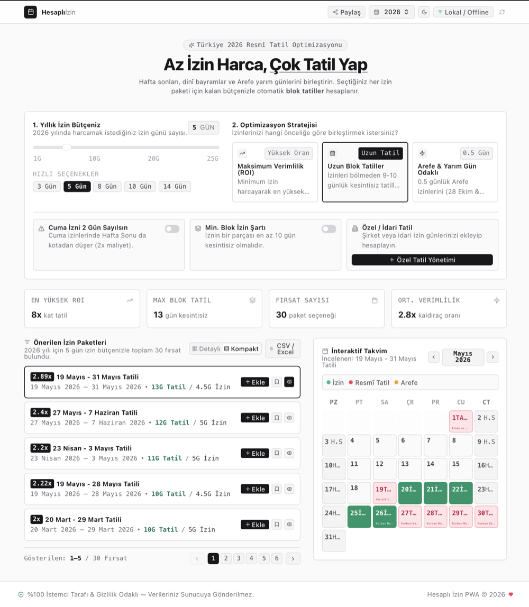
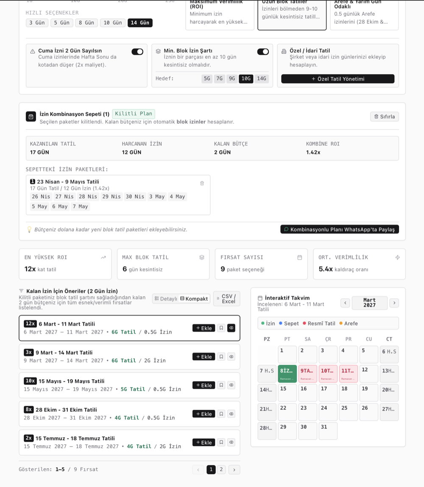
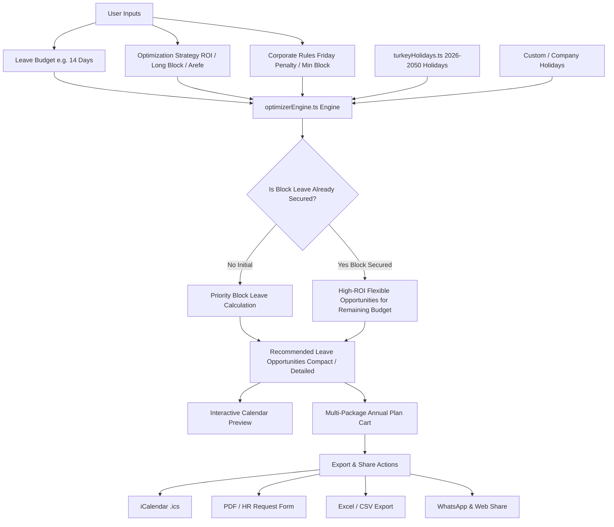

# 🏖️ Hesaplı İzin — Turkey Annual Leave Optimizer PWA

> **Maximize your vacation days in Turkey (2026–2050) by smartly combining public holidays, official half-days (Arefe), and weekends.**

[ 🇹🇷 Türkçe Sürüm / Turkish Version ](README_TR.md)

[](https://nextjs.org/)
[](https://www.typescriptlang.org/)
[](https://tailwindcss.com/)
[](https://web.dev/progressive-web-apps/)
[](LICENSE)


### 📸 Screenshots

| Minimalist Dashboard & Interactive Calendar | Combination Annual Leave Planner & Cart |
| --- | --- |
|  |  |

## 🌟 Overview

**Hesaplı İzin** is a production-ready, privacy-focused Progressive Web App (PWA) designed for employees working in Turkey. It calculates optimal leave schedules to yield the maximum number of consecutive off days while minimizing spent annual leave balance across **2026 to 2050**.

Everything runs **100% client-side** inside the browser. No personal data, leave preferences, or company details are ever transmitted to any remote server.

## 🔄 Workflow & Architecture



## ✨ Key Features

- 🎯 **Multi-Strategy Optimization Engine (`optimizerEngine.ts`)**:
  - **Maximum Efficiency (ROI)**: Maximizes the Return-on-Investment ratio.
  - **Long Block Vacations**: Groups contiguous off-days into unbroken 9–10+ day long breaks.
  - **Arefe & Half-Day Focus**: Capitalizes on 0.5-day Arefe opportunities.

- 📅 **Turkey Official Holidays Engine (2026 – 2050)**:
  - Supports all fixed national holidays and moving religious holidays for the next 25 years with sub-day precision.

- ⚙️ **Corporate & Legal Rule Support**:
  - **Friday Leave 2-Day Penalty Rule**: Adjusts cost calculations for companies where taking Friday off deducts Saturday/weekend from leave allowance (2x cost).
  - **Minimum X Days Block Requirement (Labor Law Art. 56)**: Filters opportunities to ensure employees satisfy mandatory continuous block leave requirements.
  - **Smart Block Warning Modal**: Warns users if they attempt to add short breaks to an empty annual plan before securing a long block vacation.

- 🛒 **Multi-Package Sequential Leave Planner & Cart**:
  - Add multiple leave packages to your annual plan cart.
  - Automatically recalculates remaining leave budget and locks selected calendar dates.
  - Automatically prioritizes long block vacations or flexible opportunities for remaining leave balance once the main block is secured.

- 🗂️ **Compact & Detailed View Switcher**:
  - Toggle between Notion-style database row compact view and detailed opportunity cards.

- 🏢 **Custom & Administrative Holiday Creator**:
  - Add company-specific holidays, local liberation days, or government-announced administrative bridge days.

- 📥 **Export & Download Options**:
  - **iCalendar (.ics)**: 1-click import into Google Calendar, Outlook, and Apple Calendar.
  - **PDF / HR Request Form**: Generates a printable annual leave request report for HR approval (`window.print()`).
  - **Excel / CSV Export**: UTF-8 BOM encoded CSV download supporting Turkish characters.
  - **WhatsApp & Native Web Share**: 1-click sharing formatted for WhatsApp and mobile share sheets.

- 🌙 **Dark / Light Mode**:
  - Complete dark and light theme switching with persistent local storage preference.

- ⚡ **Offline-First PWA & Service Worker**:
  - Built with Workbox caching strategies. Can be installed as a standalone app on iOS, Android, macOS, and Windows.

## 🛠️ Tech Stack

- **Framework**: Next.js 14+ (App Router, Static Export)
- **Language**: TypeScript (Strict type safety)
- **Styling**: Tailwind CSS v3 with dynamic dark mode
- **State Management**: Zustand with `persist` middleware (Local Storage)
- **PWA**: `@ducanh2912/next-pwa` (Service Worker, Web App Manifest)
- **Icons**: `lucide-react`
- **Date Math**: `date-fns` (Turkish locale)

## 🚀 Getting Started & Setup

```bash
# Clone repository
git clone https://github.com/your-username/hesapli-izin.git
cd hesapli-izin

# Install dependencies
npm install

# Start local development server
npm run dev

# Build static production bundle
npm run build
```

## 🚢 Deployment (GitHub Pages & CI/CD)

This repository includes a GitHub Actions workflow (`.github/workflows/deploy.yml`) that automatically builds and deploys the static PWA to **GitHub Pages** whenever code is pushed to the `main` branch.

To enable GitHub Pages for your repository:
1. Navigate to **Settings -> Pages** in your GitHub repository.
2. Select **GitHub Actions** as the deployment source.
3. Push changes to `main` and your app will be live at `https://<username>.github.io/hesapli-izin/`.

## 📁 Directory Structure

```text
hesapli-izin/
├── .github/
│   ├── screenshots/
│   │   ├── home-page.png       # Minimalist Dashboard screenshot
│   │   └── example-plan.png    # Annual plan cart screenshot
│   └── workflows/
│       └── deploy.yml          # GitHub Actions CI/CD workflow
├── public/
│   ├── manifest.json           # Web App Manifest
│   ├── .nojekyll               # Jekyll bypass for GitHub Pages
│   ├── logo-banner.jpg         # Clean Banner Logo
│   └── icon.svg                # PWA App Icon
├── src/
│   ├── app/
│   │   ├── globals.css         # Tailwind base & dark/light theme CSS
│   │   ├── layout.tsx          # Root layout & PWA metadata
│   │   └── page.tsx            # Main application dashboard page
│   ├── components/
│   │   ├── Header.tsx          # App bar with theme toggle, year picker & install button
│   │   ├── ControlsSection.tsx # Budget slider, algorithm tabs & corporate rules
│   │   ├── OpportunityCard.tsx # Leave opportunity card with export & share menu
│   │   ├── CalendarView.tsx    # Monthly interactive color-coded calendar
│   │   ├── AnnualPlanCart.tsx  # Multi-package annual vacation plan cart
│   │   ├── SummaryStats.tsx    # Key analytics metrics cards
│   │   ├── CustomHolidayModal.tsx  # Modal to create custom/company holidays
│   │   └── BlockLeaveWarningModal.tsx # Warning modal for first non-block package
│   ├── lib/
│   │   ├── optimizerEngine.ts  # Core optimization algorithms engine
│   │   ├── turkeyHolidays.ts   # 2026-2050 Turkey official holiday generator
│   │   └── exportUtils.ts      # iCalendar (.ics), CSV, PDF print & share helpers
│   ├── store/
│   │   └── useLeaveStore.ts    # Persistent Zustand application store
│   └── types/
│       └── holiday.ts          # TypeScript type definitions
├── README.md                   # English README (Standard Markdown)
├── README_TR.md                # Turkish README
├── next.config.js              # Next.js static export & PWA wrapper config
├── tailwind.config.js          # Tailwind design tokens & themes
└── tsconfig.json               # TypeScript configuration
```

## 📄 License

This project is licensed under the [MIT License](LICENSE) - see the LICENSE file for details.
