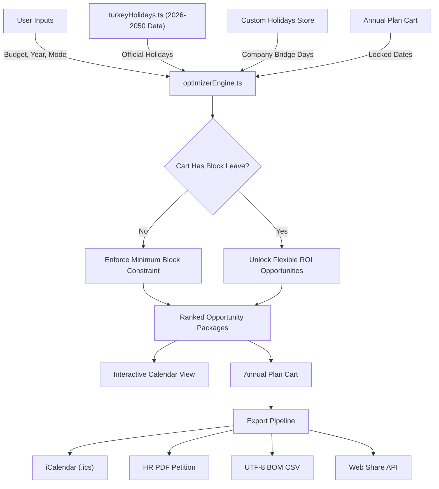

# Hesaplı İzin

> Offline-first Progressive Web App that maximizes consecutive vacation days in Turkey by calculating optimal combinations of public holidays, official half-days, and weekend bridges against annual leave balances.

[Türkçe Sürüm](README_TR.md)

[](https://github.com/AtaCanYmc/hesapli-izin/actions/workflows/ci.yml)
[](https://nextjs.org/)
[](https://www.typescriptlang.org/)
[](https://tailwindcss.com/)
[](https://web.dev/progressive-web-apps/)
[](LICENSE)


### Screenshots

| Dashboard & Calendar View | Annual Plan Cart & Export |
| :---: | :---: |
|  |  |

---

## Table of Contents

- [Overview](#overview)
- [System Architecture](#system-architecture)
- [Quick Start](#quick-start)
- [Optimization Strategies](#optimization-strategies)
- [Corporate and Legal Rules](#corporate-and-legal-rules)
- [Export Formats](#export-formats)
- [Directory Structure](#directory-structure)
- [Frequently Asked Questions](#frequently-asked-questions)
- [Contributing](#contributing)
- [License](#license)

---

## Overview

Hesaplı İzin calculates optimal annual leave schedules for employees in Turkey across 2026 through 2050. The application combines fixed national holidays, astronomical lunar shifts for religious holidays, official half-days, and weekend days to maximize consecutive time off with minimal leave deduction.

All computations run entirely in the browser using client-side TypeScript. No personal leave data, company preferences, or custom schedules are transmitted to external servers.

---

## System Architecture

The optimization pipeline processes calendar boundaries, user budget limits, corporate rules, and selected leave packages.



---

## Quick Start

### Prerequisites

- Node.js 18.x, 20.x, or 22.x
- npm 9.x or higher

### Local Development

```bash
# 1. Clone the repository
git clone https://github.com/AtaCanYmc/hesapli-izin.git
cd hesapli-izin

# 2. Install dependencies
npm install

# 3. Start local development server
npm run dev
```

Open `http://localhost:3000` in your browser.

### Static Production Build

```bash
npm run build
```

The output is generated in `./out` as a fully static, standalone Progressive Web App.

---

## Optimization Strategies

The calculation engine (`src/lib/optimizerEngine.ts`) supports three discrete optimization modes:

| Mode | Identifier | Primary Objective | Scoring Formula |
| :--- | :--- | :--- | :--- |
| Maximum Efficiency | `max-roi` | Maximizes leverage ratio of consecutive vacation days per spent leave day. | `Score = Total Off Days / Leave Days Required` |
| Long Block Vacations | `long-block` | Prioritizes single unbroken vacation blocks of 9 to 16 consecutive days. | `Score = Total Off Days` (Tie-breaker: Efficiency) |
| Arefe & Half-Day Focus | `arefe-focused` | Capitalizes on 0.5-day official holidays (e.g. 28 October, religious eve days). | `Score = Half Days Count` (Tie-breaker: Efficiency) |

---

## Corporate and Legal Rules

Hesaplı İzin accounts for statutory labor requirements and common corporate leave policies in Turkey:

| Rule | Configuration Key | Legal / Corporate Context | Engine Behavior |
| :--- | :--- | :--- | :--- |
| Friday 2-Day Deduction | `includeFridayPenalty` | Many Turkish corporate policies charge 2 leave days for taking Friday off to cover Saturday. | Increases leave deduction by 1.0 day for Friday leaves, lowering the ROI score of Friday bridges. |
| Minimum Block Leave | `minBlockEnabled` | Turkish Labor Law No. 4857, Article 56 stipulates that at least one leave segment must be a continuous block of at least 10 days. | Restricts initial recommendations to plans satisfying `minBlockDays` until at least one compliant block is locked in the cart. |
| Dynamic Block Relaxation | Engine logic | Once a compliant block leave is added to the cart, remaining budget should not be constrained to long blocks. | Automatically lifts the block constraint for subsequent recommendations, allowing short, high-efficiency bridges. |
| Custom Holidays | `customHolidays` | Accommodates corporate shutdown days, regional holidays, or administrative bridge days declared by presidential decree. | Treats custom dates as non-working days in the year calendar map, reducing required leave days. |

---

## Export Formats

Users can export single opportunities or entire combination plans:

| Format | Target Platform | File / Delivery Mechanism |
| :--- | :--- | :--- |
| iCalendar (`.ics`) | Google Calendar, Apple Calendar, Microsoft Outlook | Generates RFC 5545 `.ics` blobs with event reminders and summary metadata. |
| HR Leave Petition | Corporate Human Resources departments | Triggers a dedicated print stylesheet formatted as an official employee leave request form. |
| Excel / Spreadsheet | Financial and planning spreadsheets | Generates UTF-8 encoded CSV files with byte order mark (BOM) for Turkish character compatibility in Excel. |
| Web Share | Mobile devices, messaging apps | Formats plan summaries for native sharing via the Web Share API or WhatsApp direct links. |

---

## Directory Structure

```text
hesapli-izin/
├── .editorconfig              # Universal indentation and whitespace rules
├── .gitattributes             # Line ending normalization and export exclusions
├── .github/
│   ├── CODEOWNERS             # Code review routing
│   ├── ISSUE_TEMPLATE/        # Structured issue forms (bug report, feature request)
│   ├── PULL_REQUEST_TEMPLATE/ # Pull request template enforcing Conventional Commits
│   ├── dependabot.yml         # Automated weekly dependency updates
│   ├── screenshots/           # Application screenshots for documentation
│   └── workflows/
│       ├── ci.yml             # Automated matrix testing, type checks, and link audit
│       ├── deploy.yml         # GitHub Actions deployment to GitHub Pages
│       └── release-please.yml # Automated semantic versioning and changelogs
├── .gitignore                 # Build artifact and secret exclusion rules
├── .markdownlint.json         # Disciplined markdown lint configuration
├── LICENSE                    # MIT open-source license
├── README.md                  # Primary English technical documentation
├── README_TR.md               # Turkish documentation mirror
├── ROADMAP.md                 # Product milestones and planned architectural enhancements
├── SECURITY.md                # Vulnerability disclosure SLA and privacy guarantee
├── next-env.d.ts              # Next.js TypeScript definitions
├── next.config.js             # Static export and PWA configuration
├── package.json               # Package metadata and script runners
├── public/                    # Static assets, PWA manifests, and icons
├── src/
│   ├── app/                   # Next.js App Router (layout, page, root styles)
│   ├── components/            # Modular React components (calendar, cart, controls, cards)
│   ├── data/                  # Static Turkish holiday datasets
│   ├── lib/                   # Optimization algorithms, holiday generator, export utilities
│   ├── store/                 # Zustand persistent local state store
│   └── types/                 # Domain TypeScript interfaces and types
├── tailwind.config.js         # Tailwind CSS design system tokens
└── tsconfig.json              # TypeScript compiler configuration
```

---

## Frequently Asked Questions

#### Does this application transmit employee data to any remote server?
No. The application is packaged as a static single-page PWA. All holiday calculations, budget allocations, and saved packages execute in client-side JavaScript. Persistent data resides exclusively in the browser's `localStorage`.

#### How are Islamic religious holidays calculated for 2026 through 2050?
Religious holidays in Turkey follow the lunar Hijri calendar, shifting approximately 10 to 11 days earlier in the Gregorian calendar each solar year. Calculation dates in `src/data/holidays.json` and `src/lib/turkeyHolidays.ts` align with verified astronomical moon phase projections from the Presidency of Religious Affairs.

#### How does the engine satisfy Turkish Labor Law Article 56?
Article 56 of Labor Law No. 4857 mandates that annual leave may be divided by mutual consent, provided that at least one segment consists of not less than 10 continuous days. The optimizer defaults to enforcing this threshold. Once a user locks a qualifying block into the annual plan cart, the engine relaxes this requirement for remaining days, allowing high-efficiency short leaves.

#### Can this application run offline?
Yes. The build incorporates `@ducanh2912/next-pwa` with Workbox runtime caching. Once loaded in a browser, all assets and holiday tables are cached locally. The app can be installed as a standalone PWA on mobile and desktop operating systems.

---

## Contributing

Review [CONTRIBUTING.md](CONTRIBUTING.md) for details on code style, branch conventions, and pull request submission guidelines.

---

## License

This project is licensed under the [MIT License](LICENSE).
