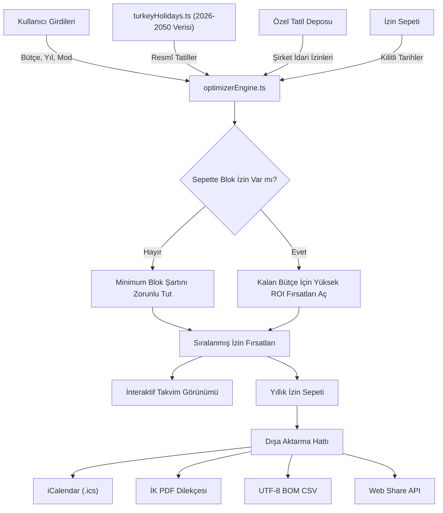

# Hesaplı İzin

> Resmî tatilleri, dinî bayramları, Arefeleri ve hafta sonlarını yıllık izinlerle birleştirerek minimum izin harcamasıyla maksimum kesintisiz tatil günü hesaplayan çevrimdışı öncelikli Progressive Web App (PWA).

[English Version](README.md)

[](https://github.com/AtaCanYmc/hesapli-izin/actions/workflows/ci.yml)
[](https://nextjs.org/)
[](https://www.typescriptlang.org/)
[](https://tailwindcss.com/)
[](https://web.dev/progressive-web-apps/)
[](LICENSE)


### Ekran Görüntüleri

| Dashboard ve İnteraktif Takvim | Kombinasyonlu İzin Sepeti ve Dışa Aktarım |
| :---: | :---: |
|  |  |

---

## İçindekiler

- [Genel Bakış](#genel-bakış)
- [Sistem Mimarisi](#sistem-mimarisi)
- [Hızlı Başlangıç](#hızlı-başlangıç)
- [Optimizasyon Stratejileri](#optimizasyon-stratejileri)
- [Kurumsal ve Yasal Kurallar](#kurumsal-ve-yasal-kurallar)
- [Dışa Aktarma Formatları](#dışa-aktarma-formatları)
- [Dizin Yapısı](#dizin-yapısı)
- [Sıkça Sorulan Sorular](#sıkça-sorulan-sorular)
- [Katkıda Bulunma](#katkıda-bulunma)
- [Lisans](#lisans)

---

## Genel Bakış

Hesaplı İzin, Türkiye'de çalışanlar için 2026 ile 2050 yılları arasındaki tüm resmî tatilleri kapsayan bir yıllık izin optimizasyon aracıdır. Sabit millî bayramları, Hicri takvim kaymalarına bağlı dinî bayramları, Arefe yarım günlerini ve hafta sonu köprülerini analiz ederek en az izin günüyle en uzun kesintisiz tatil bloklarını üretir.

Tüm hesaplamalar tarayıcı üzerinde istemci tarafında TypeScript ile yürütülür. İzin bütçeniz, planlarınız veya şirket tercihleriniz hiçbir uzak sunucuya gönderilmez.

---

## Sistem Mimarisi

Optimizasyon motoru, takvim haritasını, bütçe kısıtlarını, kurumsal politikaları ve sepete eklenen kilitli paketleri işler:



---

## Hızlı Başlangıç

### Gereksinimler

- Node.js 18.x, 20.x veya 22.x
- npm 9.x veya üzeri

### Yerel Geliştirme

```bash
# 1. Depoyu klonlayın
git clone https://github.com/AtaCanYmc/hesapli-izin.git
cd hesapli-izin

# 2. Bağımlılıkları yükleyin
npm install

# 3. Geliştirme sunucusunu başlatın
npm run dev
```

Tarayıcınızda `http://localhost:3000` adresini açın.

### Statik Üretim Derlemesi

```bash
npm run build
```

Derleme çıktısı `./out` dizininde tamamen statik bir Progressive Web App olarak oluşturulur.

---

## Optimizasyon Stratejileri

Hesaplama motoru (`src/lib/optimizerEngine.ts`) üç farklı optimizasyon modunu destekler:

| Mod | Belirteç | Temel Amaç | Puanlama Formülü |
| :--- | :--- | :--- | :--- |
| Maksimum Verimlilik | `max-roi` | Harcanan izin günü başına kesintisiz tatil günü kaldıraç oranını maksimize eder. | `Skor = Toplam Tatil Günü / Gerekli İzin Günü` |
| Uzun Blok Tatiller | `long-block` | Tek seferde 9 ile 16 gün arası kesintisiz uzun tatil bloklarını önceler. | `Skor = Toplam Tatil Günü` (Eşitlikte: ROI) |
| Arefe ve Yarım Gün Odaklı | `arefe-focused` | 0.5 günlük Arefe yarım günlerinin getirdiği yüksek verimliliği önceler. | `Skor = Yarım Gün Sayısı` (Eşitlikte: ROI) |

---

## Kurumsal ve Yasal Kurallar

Hesaplı İzin, Türkiye'deki iş mevzuatını ve kurumsal şirket uygulamalarını hesaba katar:

| Kural | Yapılandırma Anahtarı | Yasal / Kurumsal Bağlam | Motor Davranışı |
| :--- | :--- | :--- | :--- |
| Cuma 2 Gün Düşsün | `includeFridayPenalty` | Cuma günü izin alındığında cumartesi gününü de kotadan düşen kurum politikaları. | Cuma günleri için harcanan izin maliyetini 1.0 gün artırır ve verimlilik skorunu buna göre ayarlar. |
| Minimum Blok İzin Şartı | `minBlockEnabled` | 4857 sayılı İş Kanunu'nun 56. maddesi uyarınca yıllık iznin bir parçasının kesintisiz en az 10 gün olma zorunluluğu. | Sepette en az bir blok izin kilitlenene kadar önerileri `minBlockDays` şartını sağlayan paketlerle sınırlandırır. |
| Dinamik Blok Esnetmesi | Motor Mantığı | Sepette en az bir blok izin şartı sağlandıktan sonra kalan bütçenin blok zorunluluğunda tutulmaması. | Blok sağlandığında sonraki önerilerde blok zorunluluğunu kaldırır; 2 ila 4 günlük yüksek ROI fırsatlarını serbest bırakır. |
| Özel ve İdari Tatiller | `customHolidays` | Şirket tatilleri, yerel kurtuluş günleri veya idari tatil kararları. | Seçilen günleri çalışma günü yerine tatil olarak işaretleyerek gereken izin gününü düşürür. |

---

## Dışa Aktarma Formatları

Tek bir fırsat veya sepette birleştirilmiş yıllık plan şu formatlarda dışa aktarılabilir:

| Format | Hedef Platform | Teslim Mekanizması |
| :--- | :--- | :--- |
| iCalendar (`.ics`) | Google Calendar, Apple Calendar, Microsoft Outlook | RFC 5545 standardında `.ics` takvim dosyası oluşturur. |
| İK İzin Dilekçesi | İnsan Kaynakları departmanları | Resmi şirket izin dilekçesi formatında optimize edilmiş yazdırma görünümü sunar. |
| Excel / E-Tablo | Finansal ve kişisel planlama tabloları | Excel'de Türkçe karakter bozulmasını engelleyen UTF-8 BOM kodlamalı CSV üretir. |
| Web Share | Mobil cihazlar, mesajlaşma uygulamaları | Plan özetini mobil paylaşım arayüzü veya doğrudan WhatsApp bağlantısı ile iletir. |

---

## Dizin Yapısı

```text
hesapli-izin/
├── .editorconfig              # Kodlama stili ve girinti kuralları
├── .gitattributes             # Satır sonu ve arşiv dışlama kuralları
├── .github/
│   ├── CODEOWNERS             # Kod sahipliği ve PR yönlendirmesi
│   ├── ISSUE_TEMPLATE/        # Yapılandırılmış hata ve öneri formları
│   ├── PULL_REQUEST_TEMPLATE/ # Conventional Commits denetimli PR şablonu
│   ├── dependabot.yml         # Haftalık otomatik bağımlılık güncellemeleri
│   ├── screenshots/           # Dokümantasyon ekran görüntüleri
│   └── workflows/
│       ├── ci.yml             # Matris doğrulama, tip denetimi ve bağlantı kontrolü
│       ├── deploy.yml         # GitHub Pages otomatik dağıtım iş akışı
│       └── release-please.yml # Otomatik anlamsal sürümleme ve changelog
├── .gitignore                 # Derleme çıktısı ve gizli dosya yoksayma listesi
├── .markdownlint.json         # Markdown lint yapılandırması
├── LICENSE                    # MIT açık kaynak lisansı
├── README.md                  # İngilizce teknik dokümantasyon
├── README_TR.md               # Türkçe teknik dokümantasyon
├── ROADMAP.md                 # Ürün yol haritası ve gelecek hedefleri
├── SECURITY.md                # Güvenlik politikası ve gizlilik taahhüdü
├── next-env.d.ts              # Next.js TypeScript tanımları
├── next.config.js             # Statik dışa aktarma ve PWA yapılandırması
├── package.json               # Bağımlılıklar ve çalıştırma komutları
├── public/                    # Statik dosyalar, manifest ve ikonlar
├── src/
│   ├── app/                   # Next.js App Router sayfaları ve stilleri
│   ├── components/            # Modüler React bileşenleri
│   ├── data/                  # 2026-2050 Türkiye tatil veri seti
│   ├── lib/                   # Optimizasyon motoru, tatil hesaplayıcı ve dışa aktarım
│   ├── store/                 # Zustand yerel durum yönetimi
│   └── types/                 # TypeScript veri modelleri
├── tailwind.config.js         # Tailwind CSS tasarım token'ları
└── tsconfig.json              # TypeScript derleyici yapılandırması
```

---

## Sıkça Sorulan Sorular

#### Bu uygulama kullanıcı verilerini uzak bir sunucuya iletiyor mu?
Hayır. Uygulama tamamen istemci taraflı çalışan statik bir PWA'dır. Tüm hesaplamalar tarayıcı belleğinde gerçekleşir. Kalıcı tercihler sadece tarayıcınızın `localStorage` alanında saklanır.

#### 2026 ile 2050 arasındaki dinî bayram tarihleri nasıl hesaplanır?
Dinî bayramlar Ay takvimine göre belirlenir ve her güneş yılında yaklaşık 10-11 gün geriye kayar. `src/data/holidays.json` ve `src/lib/turkeyHolidays.ts` içindeki tarihler, Diyanet İşleri Başkanlığı'nın astronomik hesaplamalarıyla tam uyumludur.

#### Sistem 4857 sayılı İş Kanunu'nun 56. maddesini nasıl uygular?
İş Kanunu 56. madde uyarınca yıllık izin tarafların anlaşmasıyla bölünebilir; ancak bir bölümünün kesintisiz 10 günden az olmaması gerekir. Sistem varsayılan olarak bu kuralı denetler. Sepete 10+ günlük bir blok eklendiğinde kalan bütçe için blok kısıtı otomatik olarak kaldırılır.

#### Uygulama internet bağlantısı olmadan çalışır mı?
Evet. Uygulama `@ducanh2912/next-pwa` ve Workbox önbelleklemesi içerir. Tarayıcıda bir kez açıldıktan sonra çevrimdışı olarak çalışmaya devam eder ve cihaza PWA olarak yüklenebilir.

---

## Katkıda Bulunma

Kod stili, dal adlandırma kuralları ve PR süreçleri için [CONTRIBUTING.md](CONTRIBUTING.md) dosyasını inceleyin.

---

## Lisans

Bu proje [MIT Lisansı](LICENSE) altında lisanslanmıştır.
