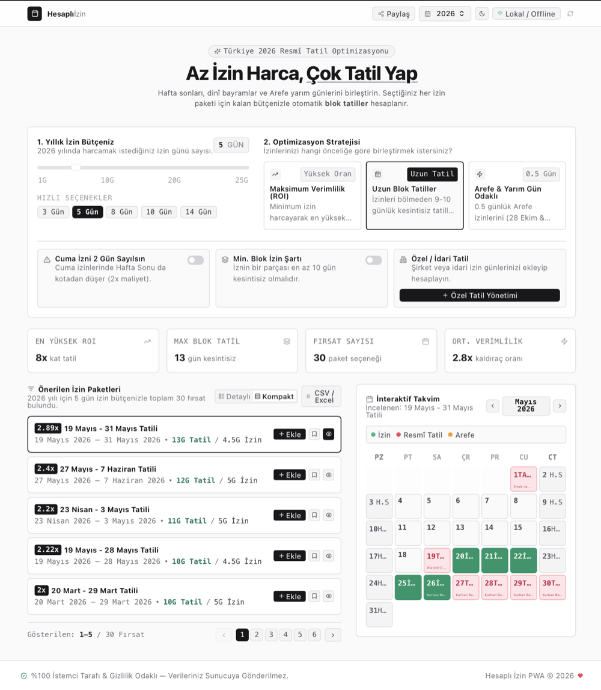
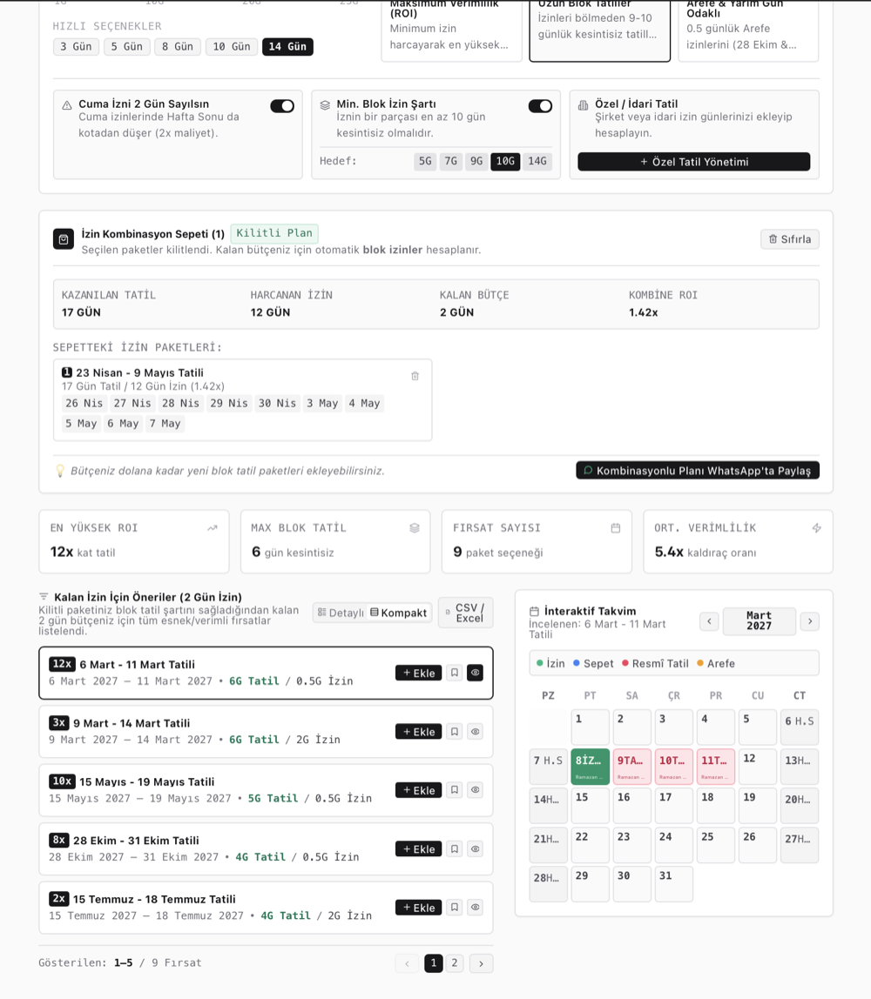
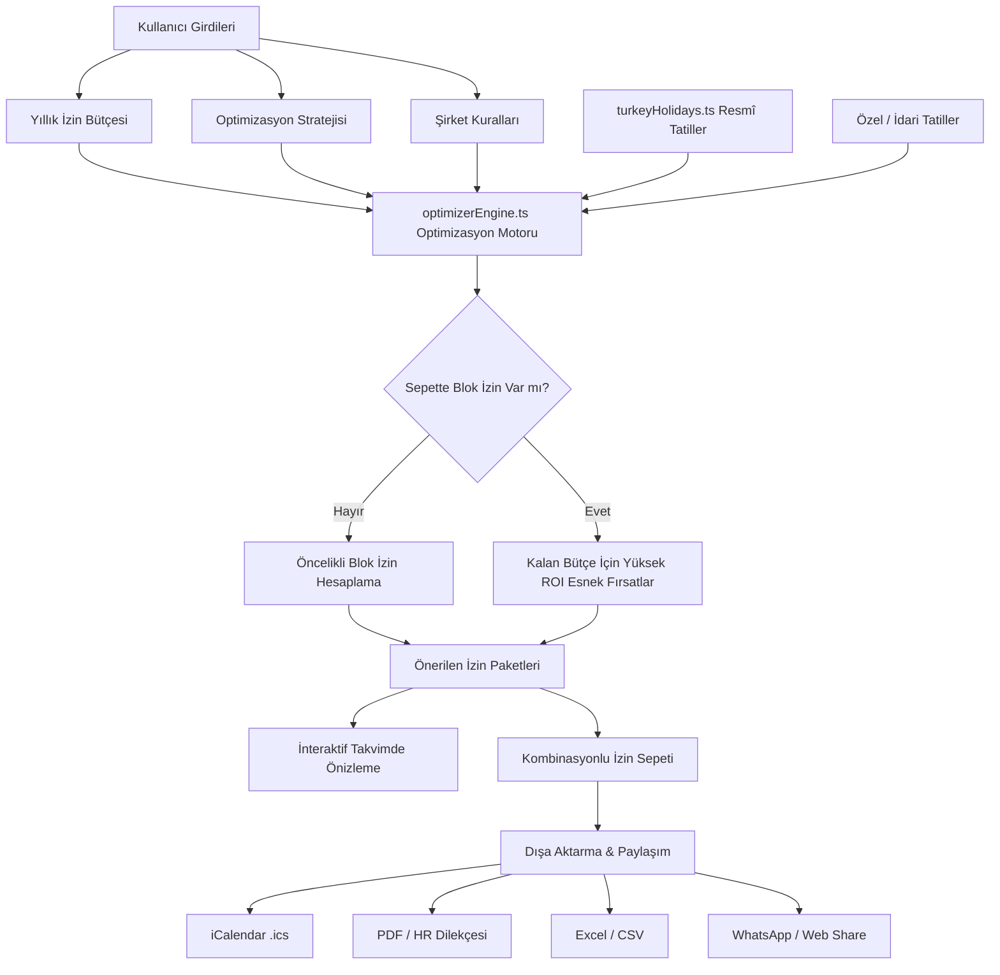

# 🏖️ Hesaplı İzin — Türkiye Yıllık İzin Optimizasyonu PWA

> **Resmî tatilleri, Arefeleri ve hafta sonlarını yıllık izinlerinizle birleştirerek maksimum kesintisiz tatil günü elde edin.**

[ 🇬🇧 English Version ](README.md)

[](https://nextjs.org/)
[](https://www.typescriptlang.org/)
[](https://tailwindcss.com/)
[](https://web.dev/progressive-web-apps/)
[](LICENSE)


### 📸 Ekran Görüntüleri

| Minimalist Dashboard & İnteraktif Takvim | Kombinasyonlu İzin Sepeti & Raporlama |
| --- | --- |
|  |  |

## 🌟 Genel Bakış

**Hesaplı İzin**, Türkiye'de çalışanlar için geliştirilmiş, resmî tatilleri, dinî bayramları (Arefeler dahil) ve hafta sonlarını yıllık izinlerle akıllıca birleştirerek **minimum izin günü harcayarak maksimum kesintisiz tatil** elde etmeyi sağlayan, %100 çevrimdışı çalışan bir **Progressive Web App (PWA)** uygulamasıdır.

Tüm hesaplamalar **%100 istemci tarafında (client-side)** tarayıcınızda gerçekleşir. İzin bütçeniz, seçtiğiniz planlar veya şirket bilgileri hiçbir sunucuya gönderilmez.

## 🔄 Akış ve Çalışma Mantığı



## ✨ Öne Çıkan Özellikler

- 🎯 **3 Farklı Optimizasyon Algoritması (`optimizerEngine.ts`)**:
  - **Maksimum Verimlilik (ROI)**: Verimlilik skoru kaldıraç oranını maksimize eder.
  - **Uzun Blok Tatiller**: İzinleri bölmeden 9–10+ günlük kesintisiz tatil blokları oluşturur.
  - **Arefe & Yarım Gün Odaklı**: 0.5 günlük Arefe kaldıraçlarını önceliklendirir.

- 📅 **2026 – 2050 Türkiye Resmî Tatil Zekası**:
  - Önümüzdeki 25 yılın tüm sabit millî tatillerini ve Hicri takvim kaymalarına göre hesaplanan Ramazan & Kurban Bayramı tarihlerini otomatik hesaplar.

- ⚙️ **Özel Şirket & Kanun İzin Kuralları**:
  - **Cuma İzni 2 Gün Sayılsın Kuralı**: Cuma izinlerinde hafta sonu kotadan düşen kurumlar için 2x maliyet hesabı.
  - **Min. X Gün Blok İzin Şartı (İş Kanunu m. 56)**: İznin bir parçasının en az 10 gün kesintisiz olma zorunluluğunu denetler.
  - **Akıllı Blok İzin Uyarısı**: Sepet boşken ilk olarak kısa izin eklenmeye çalışıldığında kullanıcıyı uyarır.

- 🛒 **Çoklu İzin Paket Seçimi & Sıralı Optimizasyon**:
  - Bir izin paketi sepete eklendiğinde kalan bütçe otomatik hesaplanır ve kilitli paketler dışındaki tarihler için öncelik **Uzun Blok İzinlere** veya esnek verimli fırsatlara verilir.
  - **Kombinasyonlu İzin Sepeti**: Yıl boyunca farklı bayramları birleştirerek toplam tatil kazancını hesaplar.

- 🗂️ **Kompakt & Detaylı Görünüm Seçeneği**:
  - Önerilen paketleri Notion veritabanı satırı formatında kompakt veya detaylı kart görünümünde listeleyebilirsiniz.

- 🏢 **Özel & İdari Tatil Yönetimi**:
  - Şirket izin günlerinizi veya sonradan ilan edilen idari izinleri ekleyip hesaba dahil edin.

- 📥 **Dışa Aktarma, İndirme ve Paylaşım**:
  - **iCalendar (.ics)**: Google Calendar, Outlook ve Apple Calendar'a tek tıkla aktarma.
  - **PDF / HR İzin Dilekçesi**: İnsan Kaynakları onayına sunulmaya hazır yazdırılabilir rapor (`window.print()`).
  - **Excel / CSV**: Türkçe karakter destekli UTF-8 BOM kodlamalı `.csv` indirmesi.
  - **WhatsApp & Web Share API**: Tek tıkla WhatsApp ve mobil paylaşım sheet'i üzerinden plan gönderme.

- 🌙 **Koyu (Dark) ve Açık (Light) Tema Desteği**:
  - Güneş / Ay ikonu ile anlık tema geçişi ve kalıcı tercih saklama.

- ⚡ **Offline-First PWA**:
  - Mobil (iOS / Android) ve masaüstü cihazlara çevrimdışı uygulama olarak yüklenebilir.

## 🛠️ Teknoloji Yığını

- **Framework**: Next.js 14+ (App Router, Static Export)
- **Dil**: TypeScript (Tam Tip Güvenliği)
- **Stil**: Tailwind CSS v3 (Karanlık/Açık Tema)
- **State**: Zustand (`localStorage` Kalıcılığı)
- **PWA**: `@ducanh2912/next-pwa` (Service Worker, Manifest)
- **İkonlar**: `lucide-react`
- **Tarih Kütüphanesi**: `date-fns` (Türkçe Yerelleştirme)

## 🚀 Kurulum ve Yerel Geliştirme

```bash
# Depoyu klonlayın
git clone https://github.com/your-username/hesapli-izin.git
cd hesapli-izin

# Bağımlılıkları yükleyin
npm install

# Geliştirme sunucusunu başlatın
npm run dev

# Statik production derlemesi yapın
npm run build
```

## 📁 Dizin Yapısı

```text
hesapli-izin/
├── .github/
│   ├── screenshots/
│   │   ├── home-page.png       # Minimalist Dashboard ekran görüntüsü
│   │   └── example-plan.png    # Kombinasyonlu İzin Sepeti ekran görüntüsü
│   └── workflows/
│       └── deploy.yml          # GitHub Actions CI/CD iş akışı
├── public/
│   ├── manifest.json           # Web App Manifest
│   ├── .nojekyll               # GitHub Pages Jekyll baypass dosyası
│   ├── logo-banner.jpg         # Logolu Banner Görseli
│   └── icon.svg                # PWA Uygulama İkonu
├── src/
│   ├── app/
│   │   ├── globals.css         # Tailwind base & koyu/açık tema CSS
│   │   ├── layout.tsx          # Kök yerleşim & PWA meta verileri
│   │   └── page.tsx            # Ana uygulama dashboard sayfası
│   ├── components/
│   │   ├── Header.tsx          # Üst bar, tema değiştirici & yıl seçici
│   │   ├── ControlsSection.tsx # Bütçe kaydırıcı, algoritma sekmeleri & kurallar
│   │   ├── OpportunityCard.tsx # İzin fırsat kartı (Kompakt/Detaylı mod)
│   │   ├── CalendarView.tsx    # Aylık interaktif renk kodlu takvim
│   │   ├── AnnualPlanCart.tsx  # Yıllık izin kombinasyon sepeti
│   │   ├── SummaryStats.tsx    # Temel istatistik metrik kartları
│   │   ├── CustomHolidayModal.tsx  # Özel/idari tatil ekleme modali
│   │   └── BlockLeaveWarningModal.tsx # İlk kısa paket uyarısı modali
│   ├── lib/
│   │   ├── optimizerEngine.ts  # Temel optimizasyon algoritma motoru
│   │   ├── turkeyHolidays.ts   # 2026-2050 Türkiye resmî tatil üreteci
│   │   └── exportUtils.ts      # iCalendar (.ics), CSV, PDF print & paylaşım yardımcıları
│   ├── store/
│   │   └── useLeaveStore.ts    # Kalıcı Zustand uygulama deposu
│   └── types/
│       └── holiday.ts          # TypeScript tip tanımları
├── README.md                   # English README (Linter uyumlu varsayılan)
├── README_TR.md                # Türkçe README
├── next.config.js              # Next.js statik export & PWA sarmalayıcı yapılandırması
├── tailwind.config.js          # Tailwind tasarım token'ları ve temaları
└── tsconfig.json               # TypeScript yapılandırması
```

## 📄 Lisans

Bu proje [MIT Lisansı](LICENSE) altında lisanslanmıştır.
